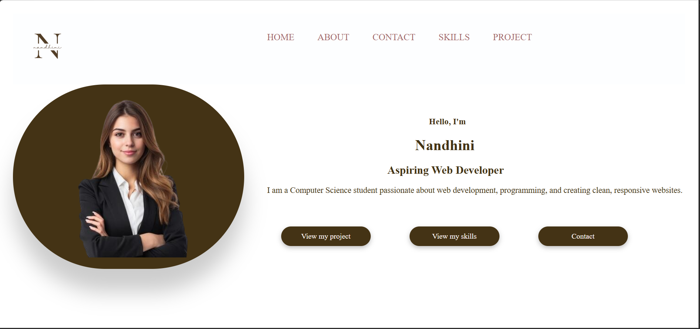

# 🚀 Personal Portfolio Website

A clean, responsive, and professional portfolio website built to showcase my profile, technical skills, and engineering projects. 

### 🌐 Live Link
👉 **[View My Live Portfolio](https://vercel.app)**

---

## 📸 Project Preview
Below is a preview of the live website user interface:

---

## 🛠️ Built With
* **Structure:** HTML5 (`index.html`)
* **Styling:** CSS3 (located in `/CSS`)
* **Interactivity:** JavaScript (located in `/js`)
* **Assets:** Custom images and icons (located in `/assets`)
* **Deployment:** Hosted on Vercel

---

## 📂 Repository Structure
An overview of the files included in this project:
* `index.html` - The main entry point and structural core of the application.
* `/pages` - Contains additional site pages (such as the updated Contact section).
* `/data` - Data modules or configuration files driving site content.
* `/assets` - Storage for media components and background layouts.
* `/CSS` - Main stylesheets controlling formatting and responsiveness.
* `/js` - Logic handling dynamic components and interactive features.

---

## ⚙️ Core Features
* **Responsive Architecture:** Fully optimized for seamless presentation across mobile phones, tablets, and desktops.
* **About Me:** Summarizes my current academic journey as an Artificial Intelligence & Data Science student.
* **Project Gallery:** Dedicated display sections designed to showcase individual technical builds and descriptions.
* **Contact Interface:** Integrated portal facilitating professional network outreach.
